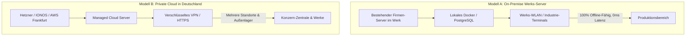

# 🚀 LogiFlow Systems | Bereitstellungs- & Hosting-Modelle für Geschäftskunden

Dieses Dokument dient als offizielle technische und vertriebliche Vorlage für Interessenten und Käufer von **LogiFlow Systems**. Es zeigt Kunden auf, wie flexibel sich LogiFlow in jede Betriebsinfrastruktur (von 50 bis 1.000+ Mitarbeitern) einfügt.

---

## 🏢 Zwei flexible Betriebsmodelle für Ihre Käufer

Kunden haben die uneingeschränkte Wahlfreiheit zwischen maximaler lokaler Datenkontrolle (On-Premise) und betriebsfreiem Cloud-Komfort (Managed Cloud):



---

### 1. Modell A: On-Premise (Lokaler Werks-Server) – *Vom Mittelstand bevorzugt*
* **Ideal für:** Fertigungsbetriebe, Maschinenbauer und Automotive-Zulieferer, die keine Produktionsdaten ins Internet übertragen dürfen (Geheimhaltung / IATF 16949).
* **Funktionsweise:**
  - LogiFlow läuft als schlanker Docker-Container auf einem lokalen Server (Windows Server oder Linux) im firmeneigenen Serverraum.
  - Alle Tablets, Touch-Terminals und Barcode-Handscanner verbinden sich direkt über das interne Werks-WLAN.
* **Vorteile für den Käufer:**
  - **100% Ausfallsicherheit:** Funktioniert selbst dann unterbrechungsfrei weiter, wenn die Internetverbindung des Werks komplett abreißt.
  - **Keine monatlichen Cloud-Gebühren:** Einmalige Einrichtung, dauerhaft lizenzfreier Betrieb.
  - **Einhaltung strengster Datenschutzauflagen (DSGVO):** Sämtliche Betriebs- und Personaldaten bleiben physisch im Werk.

---

### 2. Modell B: Managed Private Cloud (Standortübergreifend)
* **Ideal für:** Unternehmen mit mehreren Produktionshallen, Außenlagern oder mobilem Vertrieb.
* **Funktionsweise:**
  - Das System wird auf einem dedizierten deutschen Cloud-Server (z.B. Hetzner Cloud, IONOS oder AWS Frankfurt) gehostet.
  - Der Zugriff erfolgt über moderne verschlüsselte HTTPS-Verbindungen oder gesicherte Firmen-VPN-Tunnel.
* **Vorteile für den Käufer:**
  - **Keine eigene Server-Hardware im Werk erforderlich:** Kein Wartungsaufwand für die interne IT-Abteilung.
  - **Standortübergreifende Echtzeit-Transparenz:** Werksleiter oder Geschäftsführer können den 4-Sektoren-Leitstand von überall in Echtzeit einsehen.
  - **Automatische Backups:** Stündliche Cloud-Sicherungen ohne manuellen Aufwand.

---

## 🛠️ Schnelle 1-Klick-Inbetriebnahme (Docker Compose)

Für Kunden stellen wir ein schlüsselfertiges `docker-compose.yml` Paket bereit. Die gesamte Plattform (Datenbank + LogiFlow Web-Server) startet in unter 2 Minuten:

```bash
# 1. Konfiguration prüfen und Container starten
docker-compose up -d

# 2. Sofort im Werks-Browser erreichbar:
# http://logiflow.lokal:3000
```

---

## 💡 Verkaufsargument für Kundengespräche:
> *"Im Gegensatz zu SAP oder Infor, die Sie in teure, starre US-Cloud-Abos zwingen, entscheidet bei LogiFlow allein Ihr Kunde: Ob auf dem eigenen Werks-Server im Keller oder in der privaten Cloud – Sie behalten die volle Kontrolle über Ihre Kosten und Daten."*
