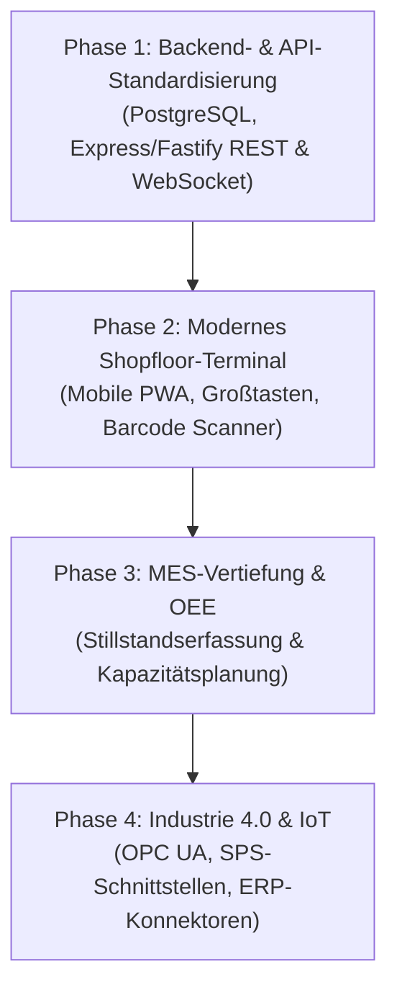

# 📊 LogiFlow Systems | Umfassende Konkurrenzanalyse & Transformations-Roadmap

## 🎯 1. Executive Summary

LogiFlow besetzt eine entscheidende Marktlücke im Bereich industrieller Fertigungs- und Lagerleitsysteme (ERP & MES): **Keine wiederkehrenden Lizenzgebühren, schlanke Architektur, 100% Anpassbarkeit und sofort einsatzbereite Shopfloor-Terminals**. 

Große Marktteilnehmer wie **Infor (CloudSuite / LN / WMS)**, **SAP (S/4HANA & Digital Manufacturing)** und **MPDV (Hydra)** dominieren zwar Großkonzerne, scheitern jedoch häufig im produzierenden Mittelstand an:
- Astronomischen Lizenz- und Beraterkosten (oft 6- bis 7-stellige Budgets).
- Überladenen, benutzerunfreundlichen Oberflächen für Maschinenbediener und Lageristen.
- Monatelangen bis jahrelangen Einführungszyklen.

Dieses Dokument analysiert die Wettbewerber im Detail, identifiziert LogiFlows Differenzierungsmerkmale und definiert den 4-stufigen Entwicklungs- und Transformationsplan zur Etablierung von LogiFlow als führende Mittelstands-Plattform.

---

## 🏢 2. Detaillierte Wettbewerberanalyse

### 1. Infor (Infor CloudSuite Industrial / LN & Infor WMS)
* **Marktposition:** Stark im diskreten Maschinenbau, Automotive und Luftfahrt.
* **Stärken:**
  - Tiefgehende Branchenvorkonfigurationen.
  - Leistungsstarke Advanced Planning & Scheduling (APS) Module.
  - Infor OS Middleware für Drittsystem-Integration.
* **Schwächen:**
  - **Extrem hohe TCO (Total Cost of Ownership):** Teure Pro-User-Monatslizenzen, obligatorische Cloud-Verträge.
  - **Komplexität auf dem Shopfloor:** Viele Untermenüs; Barcode-Buchungen erfordern zu viele Klicks.
  - **Berater-Abhängigkeit:** Jede Prozessänderung erfordert externe Dienstleister zu Tagessätzen von 1.500 €+.

### 2. SAP Digital Manufacturing (DM) & SAP ME / MII
* **Marktposition:** Weltweiter De-facto-Standard in DAX-Konzernen.
* **Stärken:** Nahtlose Integration in SAP Finanz-, Controlling- und Beschaffungsmodule.
* **Schwächen:** Für kleine und mittlere Betriebe (KMU / Mittelstand) finanziell und organisatorisch untragbar. Hohe Latenzen, rigide Datenmodelle.

### 3. MPDV Hydra (Deutscher MES-Standard)
* **Marktposition:** Weit verbreitet im deutschen Mittelstand (VDI 5600 konform).
* **Stärken:** Ausgereifte Betriebs- und Maschinendatenerfassung (BDE/MDE), OEE-Analysen, Werkzeugverwaltung.
* **Schwächen:** Veraltete UI-Konzepte, schwerfällige mobile Bedienung, proprietäre Lizenzierungsmodelle je Terminal.

### 4. Odoo Manufacturing (Open-Source / KMU)
* **Marktposition:** Beliebt bei Startups und kleineren Handelsbetrieben.
* **Stärken:** Moderne Web-Oberfläche, schneller Einstieg.
* **Schwächen:** Schwach bei komplexer Fertigung, kein nativer 4-Sektoren-Produktionsleitstand, unzureichende Pufferlager- und Qualitätskarantäne-Logik für harte Industrieumgebungen.

---

## ⚖️ 3. Konkurrenz-Vergleichsmatrix

| Kriterium | Infor CloudSuite | SAP DM | MPDV Hydra | Odoo Enterprise | **LogiFlow Systems** |
| :--- | :---: | :---: | :---: | :---: | :---: |
| **Lizenzmodell** | Pro User / Monat (€€€€) | Konzernvertrag (€€€€€) | Modul-/Terminal-Lizenz (€€€) | Pro User (€€) | **Lizenzfrei (Einmalinvestition / 0 € Abogebühr)** |
| **Implementierungszeit** | 6 – 18 Monate | 9 – 24 Monate | 4 – 9 Monate | 2 – 5 Monate | **1 – 3 Wochen** |
| **4-Sektoren-Echtzeit-Leitstand** | Komplexe Dashboards | Schwerfällig | Klassische Tabellen | Eingeschränkt | **Nativ, übersichtlich & in Echtzeit** |
| **Behälterpuffer & Kistenlager** | WMS-Zusatzpaket nötig | Schwer zu konfigurieren | Vorhanden | Schwach | **Integriertes Barcode-Behältertracking** |
| **QS-Sperrlager mit Workflow** | Schwerfällige Freigaben | Schwerfällige Freigaben | Vorhanden | Nur Basis-Status | **1-Klick Sperre & digitaler Prüfprozess** |
| **Shopfloor-Tablet-Bedienung** | Zu viele Klicks | Hantelig | Spezifische Terminals | Gut | **Ultra-schnell (Großflächen-Touch, Barcode-Fokus)** |
| **Cloud-Zwang & DSGVO** | Hoher Cloud-Zwang | Hybrid / Cloud | On-Premise dominant | Cloud / On-Prem | **100% On-Premise oder Private Cloud (DSGVO-konform)** |

---

## 🔍 4. GAP-Analyse: Wo steht LogiFlow heute?

### Bereits realisierte Kernstärken:
1. **Live 4-Sektoren-Leitstand:** Sofortige visuelle Übersicht über Rohmaterial, Zuschnitt/Vorbereitung, Montage und Endabnahme/Versand.
2. **Behälterpuffer & Regallager:** Praktische Kisten- und Palettenverfolgung direkt am Entstehungsort.
3. **QS-Sperrlager:** Physische und logische Sperrung fehlerhafter Chargen verhindert Ausschuss-Weiterverarbeitung.
4. **Barcode-Schnellbuchungsterminal:** Minimaler Schulungsaufwand für Arbeiter (Scan -> Aktion -> Fertig).
5. **Mehrsprachigkeit (DE, EN, TR):** Optimal für multinationale Belegschaften.

### Entwicklungspotenziale (Nächste Evolutionsstufe):
1. **Industrielle Datenbank-Persistenz:** Migration von dateibasierten Datensätzen (JSON/CSV) zu einer hochrobusten PostgreSQL/SQLite-Architektur.
2. **Automatisierte Maschinendatenerfassung (OPC UA / MQTT):** Direkte Signalerfassung von SPS, Pressen, Sägen und Robotern ohne manuelle Eingabe.
3. **Rollenbasiertes Rechtesystem (RBAC):** Eindeutige Profile für Bediener, Vorarbeiter, Qualitätsprüfer und Werkleitung.
4. **OEE- & Stillstandserfassung:** Standardisierte Erfassung von Stillstandsgründen (Rüsten, Störung, Materialmangel).

---

## 🚀 5. Der 4-Phasen-Transformationsplan

### Phase 1: Robuste Kern-Architektur & API-Schicht (Woche 1)
- **Ziel:** Skalierbare Datenbasis für hunderte gleichzeitige Buchungen.
- **Maßnahmen:**
  - Relationales Datenbankschema: `artikel`, `auftraege`, `arbeitsgaenge`, `behaelter_puffer`, `sperrlager_vorgaenge`, `benutzer`.
  - Bidirektionale WebSocket-Verbindung für verzögerungsfreie Leitstand-Aktualisierungen.
  - JWT-basierte Benutzeranmeldung (optional PIN- / RFID-Scan für Werker).

### Phase 2: Industrie-Tablet & Mobile PWA (Woche 2)
- **Ziel:** Höchste Werker-Akzeptanz im direkten Vergleich zu Infor und SAP.
- **Maßnahmen:**
  - Ergonomisches UI für 10-Zoll-Tablets an Arbeitsstationen (Handschuh-Bedienung geeignet).
  - Integration von Bluetooth-Ringscannern und Kamerascan.
  - Akustisches und optisches Feedback bei Fehlbuchungen (rotes Signal / Warnton).

### Phase 3: Qualitätsmanagement & OEE-Leitstand (Woche 3-4)
- **Ziel:** Erfüllung der Anforderungen von ISO 9001 und VDI 5600.
- **Maßnahmen:**
  - Erfassung von Gutmengen, Nacharbeit und Ausschuss mit Ursachen-Katalog.
  - Automatische Berechnung von Verfügbarkeit, Leistungsgrad und Qualitätsrate (OEE).
  - Digitaler Begleitschein mit QR-Code für jedes gefertigte Gebinde.

### Phase 4: Konnektivität & Drittsystem-Brücken (Ab Monat 2)
- **Ziel:** Nahtloses Einbetten in bestehende IT-Landschaften.
- **Maßnahmen:**
  - Standardisierter CSV/REST-Konnektor zu Finanzbuchhaltungen (DATEV, Lexware, SAP FI).
  - OPC UA Client zur Takt- und Stückzahlerfassung direkt aus der Maschinensteuerung.

---

## 💼 6. Verkaufsargumentation für den Kundenvertrieb

1. **"100% Unabhängigkeit":** Keine Kündigungsfristen, keine Preiserhöhungen von Cloud-Anbietern, keine Lizenz-Audits.
2. **"Einführung in Tagen statt Quartalen":** Die Software passt sich den Prozessen des Kunden an – nicht umgekehrt.
3. **"Werker lieben Einfachheit":** Wo Infor 5 Masken benötigt, erledigt LogiFlow die Buchung in einem einzigen Barcode-Scan.
